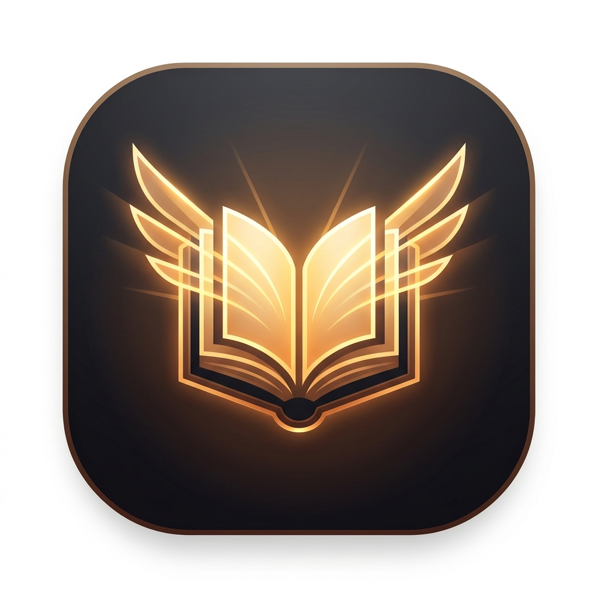

# LuminaRead 📖✨
> **Smart PDF Reader & Light Novel Typography Enhancer**  
> *Crafted with pure vibecoding — seamless book ergonomics on phone, tablet, and desktop.*

<p align="center">
  
</p>

<p align="center">
  <a href="https://github.com/YuutoEi/LuminaRead/releases/latest">
    
  </a>
  
  
</p>

---

## 📥 Unduh Aplikasi Android (.APK)

Unduh rilis terbaru langsung dari tab GitHub Releases:
👉 **[Download LuminaRead v1.0.0 APK](https://github.com/YuutoEi/LuminaRead/releases/latest)**

---

## 🌟 Sekilas Tentang LuminaRead

Kebanyakan pembaca PDF di ponsel menampilkan teks dokumen secara kaku, berukuran kecil, dan melelahkan mata saat membaca ebook atau novel panjang. **LuminaRead** hadir menyelesaikan masalah ini dengan menyulap teks PDF mentah menjadi **buku bacaan digital dengan tipografi terkurasi yang nyaman di mata**.

### ✨ Fitur Unggulan

- 📖 **Mode Tipografi Nyaman (Enhanced Book Typography)**:
  - Mengonversi teks PDF mentah menjadi format novel/buku elegan.
  - Mendeteksi dialog kutipan secara otomatis dengan highlight border vertikal.
  - Menjaga gambar ilustrasi asli dan sampul novel tetap ditampilkan rapi di tengah teks.
- 📱 **Mobile-First Ergonomics (Multi-Tier Reflow)**:
  - **Floating Bottom Bar**: Navigasi halaman ergonomis di bawah layar yang ramah satu jempol (*thumb-friendly*), dilengkapi tombol sentuh 48px+ dan pil lompat halaman instan.
  - **Zero Horizontal Leak**: Teks melipat rapi (`clamp` fluid typography) tanpa kebocoran geser horizontal.
  - **Bottom-Sheet Settings**: Pengaturan font, ukuran, tema warna kertas muncul sebagai lembaran bawah modern dengan backdrop blur.
- 🎨 **Pilihan Font & Tema Kertas Terkurasi**:
  - Pilihan font buku: **Lora (Serif Mewah)**, **Merriweather**, **Newsreader**, **Inter**, **Plus Jakarta Sans**, dan **Nunito**.
  - Tema kertas mata: *Paper Warm (Sepia)*, *Pure White*, *Dark Slate (OLED Night)*, dan *Sage Green*.
- 💾 **Ingat Halaman & Progres Otomatis**:
  - Terintegrasi database lokal IndexedDB. Posisi halaman terakhir Anda tersimpan otomatis per buku. Buka kembali kapan saja tanpa kehilangan jejak.
- 🗣️ **Text-to-Speech (TTS)**:
  - Dengarkan isi bacaan dengan pemutar suara terintegrasi.
- 📄 **Mode Dua Tampilan**:
  - Ganti kapan saja antara **Teks Tipografi Buku** atau **Layout Asli PDF**.

---

## 💻 Tech Stack & Arsitektur

- **Core**: Vanilla HTML5, CSS3, JavaScript (ES6+)
- **Engine PDF**: [PDF.js](https://mozilla.github.io/pdf.js/) (100% lokal, cepat, dan offline-ready)
- **Local Storage**: IndexedDB (Menyimpan file PDF dan progres membaca di perangkat)
- **Mobile Runtime**: [Capacitor](https://capacitorjs.com/) Android
- **Philosophy**: *Pure Vibecoding* — Mengutamakan estetika mewah, micro-interactions responsif, dan ergonomi mobile sejati.

---

## 🛠️ Menjalankan Proyek Secara Lokal

1. Clone repositori:
   ```bash
   git clone https://github.com/YuutoEi/LuminaRead.git
   cd LuminaRead
   ```
2. Pasang dependensi:
   ```bash
   npm install
   ```
3. Buka langsung di browser:
   Cukup buka file `index.html` menggunakan Live Server atau browser pilihan Anda.
4. Build APK Android:
   ```bash
   npx cap copy android
   cd android
   .\gradlew.bat assembleDebug
   ```
   File APK akan dihasilkan di `android/app/build/outputs/apk/debug/app-debug.apk`.

---

## 📄 Lisensi
Didistribusikan di bawah lisensi MIT. Bebas digunakan dan dikembangkan.
